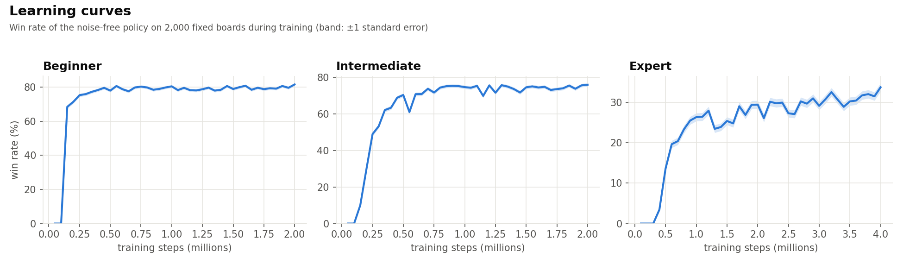

# Minesweeper with Rainbow DQN

A reinforcement learning agent that learns to play Minesweeper from rewards alone, with no hand-written rules or mine-probability calculations. It is a Double DQN extended with the Rainbow components, action masking and the board's symmetries, built on Stable-Baselines3.

## Results

Win rate of the greedy policy on the same 100,000 fixed boards per difficulty (± one standard error), under the standard rule that only the first clicked tile is guaranteed safe.

| Difficulty | Agent | Strong solver |
|---|---|---|
| Beginner (8×8, 10 mines) | **80.52% ± 0.13** | 81.79% |
| Intermediate (16×16, 40 mines) | **75.13% ± 0.14** | 78.22% |
| Expert (30×16, 99 mines) | **31.87% ± 0.15** | 40.06% |

The strong solver is the best strategy from Tu et al. (2017), [*Exploring Efficient Strategies for Minesweeper*](https://minesweepergame.com/math/exploring-efficient-strategies-for-minesweeper-2017.pdf), which computes exact mine probabilities and searches ahead when it has to guess. It uses the same first-click rule.



Beginner and intermediate had converged well before the end of training. The expert curve was still rising at 4M steps, but training was not extended further because a run of that length already takes about two days.

## Method

**Environment.** The agent sees the visible board, with 0–8 for revealed tiles and 9 for covered ones, and an action is clicking a tile. The rewards are:

| Event | Reward |
|---|---|
| Revealing safe tiles | +1 in total over a game, split evenly over the board's safe tiles |
| Winning | +1 |
| Hitting a mine | −0.9 |
| Clicking a tile with no revealed neighbour (a blind guess) | −0.1 extra |

**Network.** A fully convolutional residual network with 128 filters that outputs one Q-value per tile, so its output lines up with the board. Revealed tiles are masked out, so the agent only clicks covered tiles. The difficulties differ only in depth. Each 3×3 convolution lets a tile see one tile further, so the network is made just deep enough for every tile's receptive field to cover the whole board, since a tile's safety can depend on numbers anywhere on it:

| Difficulty | Residual blocks | Receptive field reaches | Farthest tile on the board | Parameters |
|---|---|---|---|---|
| Beginner | 3 | 7 tiles | 7 tiles | 0.9M |
| Intermediate | 7 | 15 tiles | 15 tiles | 2.1M |
| Expert | 14 | 29 tiles | 29 tiles | 4.2M |

**Rainbow components.** The final models use these components of [Rainbow](https://arxiv.org/abs/1710.02298). Adding C51, dueling and noisy networks to the Double DQN with prioritized replay improved the intermediate win rate by about 1.3 points and sped up early learning.
- **Double DQN** targets
- **Prioritized experience replay**, with the C51 loss as the priority
- **Distributional RL (C51)**, each tile predicting a distribution over 51 returns
- **Dueling network**, a board value plus a per-tile advantage centred on the covered tiles
- **Noisy networks** in place of random exploration

**Multi-step returns** are implemented but made the agent worse in every test, so the final models use one-step targets.

**Symmetry.** A rotated or mirrored board is the same puzzle. Transitions are randomly rotated and mirrored during training, and a **symmetry consistency loss** penalises the network when its Q-values for a board and a transformed copy of it disagree. On beginner and intermediate this made a single network almost as good as averaging its answers over all orientations.

**Hyperparameters** mostly follow the values from the DQN, prioritized replay and Rainbow papers. Each model's full settings are in the `_hyperparameters.json` file next to it.

## Usage

```bash
pip install -r requirements.txt
```

Watch the agent play (set `difficulty` at the top of `watch.py`):

```bash
python watch.py
```

Evaluate a model on fixed boards:

```bash
python evaluate.py expert --games 5000
```

Train, after setting `difficulty`, `version` and the settings at the top of `train.py`:

```bash
python train.py
```

Training writes tensorboard logs to `logs/` and saves the model in `models/<difficulty>/` with its settings, an evaluation curve and the best model seen during training. Set `resume = True` to continue an interrupted run from its last checkpoint.

## Repository

| File | Contents |
|---|---|
| `minesweeper.py` | The game |
| `minesweeper_env.py` | Gymnasium environment and rewards |
| `networks.py` | Residual CNN, noisy layers and policy |
| `replay_buffer.py` | Prioritized replay with multi-step returns |
| `rainbow.py` | The agent |
| `utils.py` | Training callbacks and evaluation |
| `train.py` | Training script and settings |
| `evaluate.py` | Win rate on fixed boards |
| `watch.py` | Watch the agent play |
| `models/` | The best model for each difficulty |

## License

[MIT](LICENSE)
